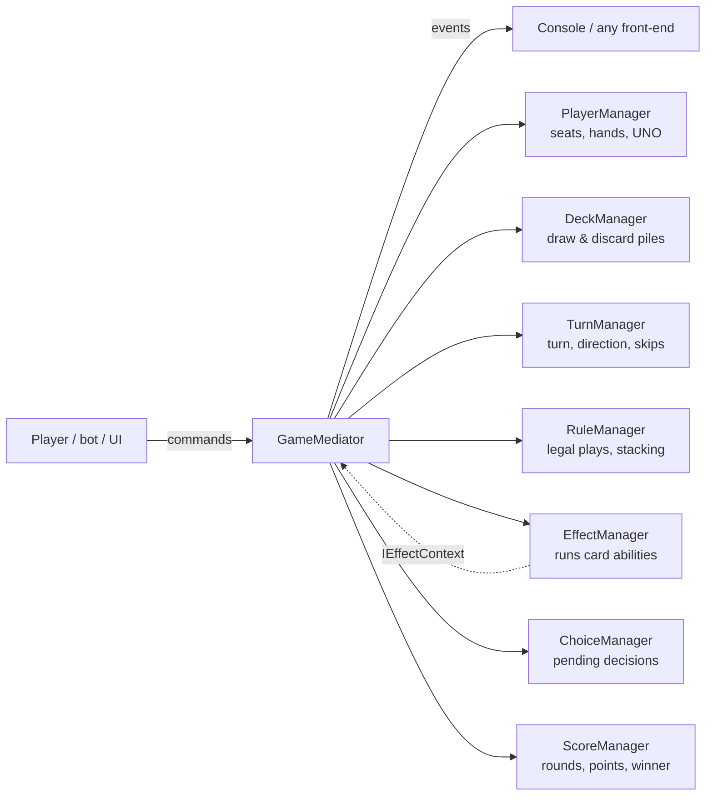

# Uno Game Engine (C# / .NET 10)

A card-game **engine**, not just one game. You design the cards (their labels, images, abilities and how many of each), choose the number of players and the house rules, and the engine runs the game. Classic Uno is a preset built with the same building blocks as any game you make.

> A Java 21 edition of the same engine lives at [uno-game-engine-java](https://github.com/mustafakhafajah/uno-game-engine-java). Both read and write the same JSON game files.

```
dotnet run --project src/UnoEngine.ConsoleApp    # play against bots or friends, or design your own cards
dotnet test                                       # 50 tests: rules, managers, effects, full bot games, replay
```

## What you can customise

| You decide | How |
|---|---|
| The cards | Label, image, free-form attributes (`color`, `symbol`, `animal`…), wild or not, copies, points |
| What cards do | Abilities from building blocks, run in the order listed (see below), or your own C# effect |
| When a card can be played | `matchRule.anyOf`: shares any of these attributes with the top card (wilds always play) |
| Players and hand size | `players.min` / `players.max`, `handSize` |
| How the game is won | First player out wins, **or** rounds to a target score you choose |
| House rules | Stacking draw cards, draw one vs draw until playable, play the drawn card, first-card rule, UNO penalty, 2-player Reverse |

## A game is data

Each game is a JSON file in [`presets/`](presets) or your own folder; the console's **card designer** writes these for you.

```json
{
  "name": "Animal Party",
  "players": { "min": 3, "max": 6 },
  "handSize": 5,
  "attributes": ["animal", "habitat"],
  "matchRule": { "anyOf": ["animal", "habitat"] },
  "settings": { "scoring": "targetScore", "targetScore": 100 },
  "cards": [
    { "id": "sly-fox", "label": "Sly Fox", "image": "images/sly-fox.png",
      "attributes": { "animal": "fox", "habitat": "forest" }, "copies": 2, "points": 10,
      "abilities": [ { "type": "swapHands", "target": "chosen" } ] }
  ]
}
```

### Ability building blocks

| Type | Parameters | Examples |
|---|---|---|
| `skip` | `count` (1) | Skip, Bear (skip 2) |
| `reverse` | – | Reverse |
| `draw` | `target`: next / all / self / chosen, `count`, `losesTurn` | +2, +4, Flood (everyone draws 1) |
| `chooseAttribute` | `attribute` | Wild (choose a colour), Migration (choose a habitat) |
| `playAgain` | – | Eagle |
| `swapHands` | `target`: chosen / next | Sly Fox |
| `rotateHands` | `direction`: forward / backward | Stampede |
| `discardAll` | `attribute` | Cat Feast (discard all your cats) |

The two presets show the range: **Classic Uno** (108 cards) and **Animal Party**, a different game made only from the same blocks.

### Your own building block

```csharp
public sealed class DrawForEachEffect : ICardEffect
{
    public string Type => "drawForEach";
    public EffectOutcome Apply(IEffectContext context)
    {
        context.DrawCards(context.NextSeat(), context.HandSize(context.CurrentSeat));
        return EffectOutcome.Done;
    }
}

var effects = EffectRegistry.CreateDefault().Register("drawForEach", _ => new DrawForEachEffect());
var game = new GameMediator(definition, ["Mustafa", "Sara"], effects: effects);
```

## Architecture



- **Mediator.** `GameMediator` is the only class that knows every manager; managers never call each other. It coordinates them for each command and publishes what happened. The rules live in the managers, so the mediator stays a coordinator rather than one class that does everything.
- **Strategy.** Each ability (`ICardEffect`) and the match rule (`IPlayRule`) is a swappable strategy.
- **Factory / Registry.** `EffectRegistry` turns the abilities in the JSON into effects, and new types plug in without changes to the engine (open/closed).
- **Command.** Every player action is a command object. The history, replayed with the same seed, recreates the game exactly (tested).
- **State.** `GamePhase`: NotStarted → AwaitingPlay ⇄ AwaitingChoice → RoundOver → GameOver.
- **Observer.** UIs subscribe to `GameMediator.EventRaised`.
- **Builder.** `GameDefinitionBuilder` creates definitions in code (Classic Uno is built this way).

### Projects

| Project | Contents |
|---|---|
| `UnoEngine.Core` | Domain: cards, players, definitions, settings, events, choices, seeded randomness |
| `UnoEngine.Rules` | Effects library, effect registry, match rules, JSON loader, validator, builder, Classic Uno |
| `UnoEngine.Engine` | `GameMediator`, the seven managers, commands, read-only `GameView`, `SimpleBot` |
| `UnoEngine.ConsoleApp` | Hot-seat game with computer players, and the card designer |
| `UnoEngine.Tests` | xUnit + Shouldly: every manager, the classic flow, every effect, plugin effects, bot games played to the end, replay |

## Game flow

1. The host picks a game, the players (people or bots) and the rules. The engine validates the definition, shuffles and deals.
2. The first card is flipped. If it has an ability, it applies as if the dealer played it (or another card is flipped, if the host chose that).
3. On your turn, play a card that matches the top card (or a wild), or draw. A playable drawn card may be played; otherwise the turn passes.
4. A played card's abilities run in order. If one needs a decision (a colour, a player), the game waits for that player.
5. With one card left, call **UNO**. Anyone who catches you first makes you draw the penalty.
6. An empty hand ends the round: either that player wins, or they score the points left in other hands and rounds continue until someone reaches the target.
